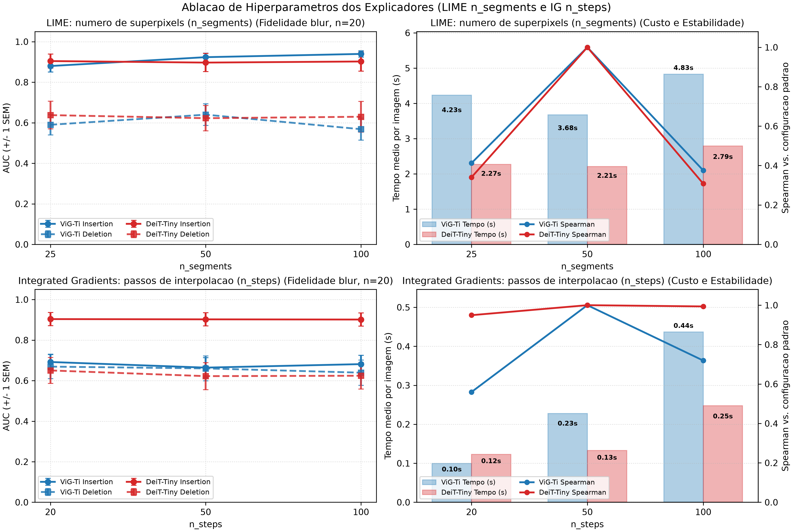
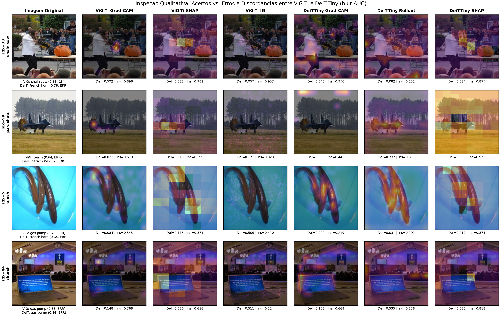
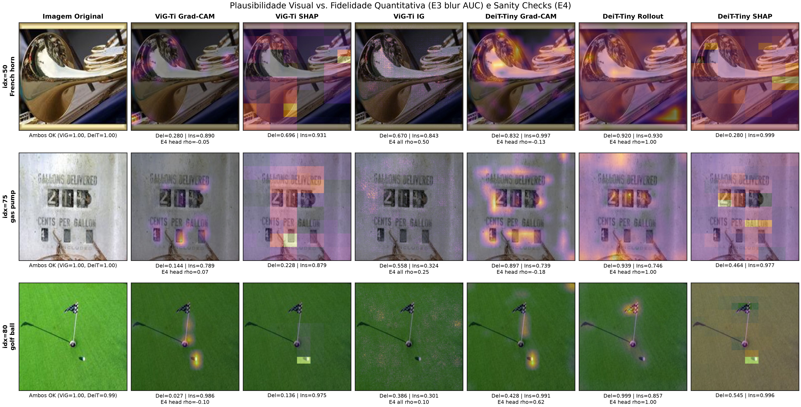

# Ablacoes de Hiperparametros e Analise Consolidada (E1 a E6)

## Objetivo
Avaliar a sensibilidade dos explicadores baseados em amostragem/integracao (LIME `n_segments` e Integrated Gradients `n_steps`), consolidar todas as metricas quantitativas de E1 a E6 em tabela mestra unica e produzir analises qualitativas contrastando acertos vs. erros e plausibilidade visual vs. fidelidade quantitativa.

## Execucao
- Script: `python -m scripts.analyze --mode all` (`scripts/analyze.py`).
- Subconjunto das ablacoes: `N = 20` imagens estratificadas (2 por classe, mesmo protocolo de E4 e E6), testando `baselines=[black, blur]` com `50` passos de Deletion/Insertion.
- Tempo das ablacoes: `385.23s` (`~6.4 min`).
- Artefatos gerados:
  - [`results/metrics/ablation_per_image.csv`](../../results/metrics/ablation_per_image.csv)
  - [`results/metrics/ablation_summary.csv`](../../results/metrics/ablation_summary.csv) e [`.json`](../../results/metrics/ablation_summary.json)
  - [`results/metrics/summary_master_table.csv`](../../results/metrics/summary_master_table.csv) e [`.json`](../../results/metrics/summary_master_table.json)
  - [`results/metrics/analysis_error_vs_correct.csv`](../../results/metrics/analysis_error_vs_correct.csv)
  - [`results/figures/ablation_sensitivity.pdf`](../../results/figures/ablation_sensitivity.pdf) e [`.png`](../../results/figures/ablation_sensitivity.png)
  - [`results/figures/analysis_errors_vs_correct.pdf`](../../results/figures/analysis_errors_vs_correct.pdf) e [`.png`](../../results/figures/analysis_errors_vs_correct.png)
  - [`results/figures/analysis_plausibility_vs_faithfulness.pdf`](../../results/figures/analysis_plausibility_vs_faithfulness.pdf) e [`.png`](../../results/figures/analysis_plausibility_vs_faithfulness.png)

## 1. Ablacao de Hiperparametros (`N = 20`, baseline `blur`)

### LIME (`n_segments in {25, 50, 100}`, padrao `50`)
| Modelo | `n_segments` | Del AUC (`blur`) | Ins AUC (`blur`) | Spearman vs. padrao | SSIM vs. padrao | Tempo medio (s/img) |
| :--- | :---: | :---: | :---: | :---: | :---: | :---: |
| `ViG-Ti` | `25` | `0.5900` | `0.8799` | `0.4124` | `0.4833` | `4.232` |
| `ViG-Ti` | `50` (padrao) | `0.6399` | `0.9235` | `1.0000` | `1.0000` | `3.676` |
| `ViG-Ti` | `100` | `0.5682` | `0.9395` | `0.3754` | `0.4416` | `4.830` |
| `DeiT-Tiny` | `25` | `0.6376` | `0.9043` | `0.3403` | `0.4590` | `2.271` |
| `DeiT-Tiny` | `50` (padrao) | `0.6225` | `0.8968` | `1.0000` | `1.0000` | `2.208` |
| `DeiT-Tiny` | `100` | `0.6296` | `0.9022` | `0.3083` | `0.4541` | `2.790` |

Observacao LIME: alterar `n_segments` muda drasticamente a particao SLIC (Spearman cai para `0.31-0.41`), mas as metricas de fidelidade permanecem estaveis em torno de `Ins ~ 0.88-0.94` e `Del ~ 0.57-0.64`. Em `n_segments=50`, ha bom compromisso entre granularidade e tempo (`3.68s` ViG / `2.21s` DeiT).

### Integrated Gradients (`n_steps in {20, 50, 100}`, padrao `50`)
| Modelo | `n_steps` | Del AUC (`blur`) | Ins AUC (`blur`) | Spearman vs. padrao | SSIM vs. padrao | Tempo medio (s/img) |
| :--- | :---: | :---: | :---: | :---: | :---: | :---: |
| `ViG-Ti` | `20` | `0.6691` | `0.6919` | `0.5593` | `0.4278` | `0.100` |
| `ViG-Ti` | `50` (padrao) | `0.6603` | `0.6642` | `1.0000` | `1.0000` | `0.228` |
| `ViG-Ti` | `100` | `0.6393` | `0.6814` | `0.7191` | `0.6547` | `0.437` |
| `DeiT-Tiny` | `20` | `0.6503` | `0.9036` | `0.9493` | `0.9063` | `0.123` |
| `DeiT-Tiny` | `50` (padrao) | `0.6222` | `0.9023` | `1.0000` | `1.0000` | `0.133` |
| `DeiT-Tiny` | `100` | `0.6241` | `0.9014` | `0.9936` | `0.9791` | `0.248` |

Observacao IG: enquanto o `DeiT-Tiny` converge quase completamente ja em `n_steps=20` (`Spearman=0.949` vs `50`, chegando a `0.994` entre `50` e `100`), a `ViG-Ti` exibe alta sensibilidade a discretizacao do caminho (`Spearman=0.559` em `20` passos e `0.719` entre `50` e `100`), pois operacoes discretas de `topk` mudam a topologia do grafo ao longo da interpolacao do baseline preto ate a imagem real. Apesar disso, a fidelidade media (Del/Ins AUC) varia pouco, justificando `n_steps=50`.

## 2. Tabela Mestra Consolidada (E1 a E6)
Resumo completo disponivel em [`results/metrics/summary_master_table.csv`](../../results/metrics/summary_master_table.csv):

- **Acuracia E1 (teste `N=785` / subconjunto `N=100`):** `ViG-Ti` `97.20%` / `97/100`; `DeiT-Tiny` `96.94%` / `97/100` (`96` acertos conjuntos, `1` acerto exclusivo por modelo, `2` erros conjuntos).
- **Grad-CAM (`14x14` simetrico):** `ViG-Ti` supera `DeiT-Tiny` em fidelidade (`Del_blur=0.461` vs `0.725`; `Ins_blur=0.914` vs `0.782`, `p < 3e-9`), passa no sanity check (`head rho=-0.015` e `-0.067`), porem tem menor estabilidade a ruido em `sigma=0.02` (`rho=0.782` vs `0.935`).
- **Attention Rollout (`DeiT-Tiny`):** supera `DeiT Grad-CAM` em fidelidade (`Del_blur=0.672`, `Ins_blur=0.851`), e o metodo mais estavel a ruido (`rho=0.994` em `0.02`; `0.882` em `0.10`), mas falha no sanity check da cabeca (`rho_head=1.000`).
- **Partition SHAP:** maior `Insertion AUC (blur)` em ambos (`0.947` ViG-Ti; `0.956` DeiT-Tiny), menor `Deletion AUC (blur)` no DeiT (`0.445`) e segundo melhor na ViG (`0.481`), passando nos sanity checks.
- **LIME:** forte no `Insertion AUC (blur)` (`0.914` ViG; `0.905` DeiT), passa nos sanity checks, mas e o mais lento (`3.72s`/`2.17s` por imagem) e o mais instavel sob ruido gaussiano (`rho=0.036`/`0.056` em `sigma=0.10`).
- **Integrated Gradients:** melhor no `DeiT-Tiny` (`Ins_blur=0.879`) do que na `ViG-Ti` (`0.684`), retem correlacao residual elevada em `all_layers` (`Spearman=0.430`/`0.419`) por dependencia das bordas de `(x - x')`.
- **Rewiring k-NN (E5, `ViG-Ti` Bloco 11):** sob `blur`, `Partition SHAP` (`0.8129`) e `Grad-CAM` (`0.8117`) induzem mais rewiring que `random` (`0.8098`, `p <= 3.06e-4`); sob `black`, pixels escuros espalhados do `random` geram artefato de rewiring precoce (`0.8312`) e falso bom `Deletion AUC` (`0.219`).

## 3. Analise Quantitativa e Qualitativa: Acertos vs. Erros
Arquivo quantitativo: [`results/metrics/analysis_error_vs_correct.csv`](../../results/metrics/analysis_error_vs_correct.csv).

- Nos `3` erros de cada modelo em `xai_subset.csv`, a confianca inicial da predicao errada e bem menor (`0.575` na ViG-Ti; `0.752` no DeiT-Tiny) do que nos `97` acertos (`0.988` e `0.993`), resultando em curvas de Deletion muito mais baixas (`Del_blur=0.085` ViG Grad-CAM; `0.076` DeiT Grad-CAM) porque poucas perturbacoes bastam para derrubar a classe falsa.
- No caso `idx=33` (`chain saw`), onde apenas a `ViG-Ti` acerta (`0.653`), o `ViG-Ti Grad-CAM` concentra relevancia na motosserra e na abobora cortada, enquanto o `DeiT-Tiny Grad-CAM` (predicao errada `French horn`, `0.759`) ativa fortemente os espectadores na parte inferior e fundo, sinalizando distracao contextual.
- No caso `idx=44` (`church`), onde ambos erram prevendo `gas pump`, `ViG-Ti Grad-CAM` e `DeiT-Tiny Rollout` mostram ambos os modelos focando na tela iluminada do laptop em primeiro plano em vez do altar ao fundo.

## 4. Plausibilidade Visual vs. Fidelidade e Sanity Checks
A figura abaixo contrasta `3` exemplos onde ambos os modelos acertam com confianca `~0.99-1.00`:
- Em `idx=50` (`French horn`) e `idx=75` (`gas pump`), `DeiT-Tiny Grad-CAM` produz mapas visualmente coerentes com partes do objeto, mas obtem `Deletion AUC (blur)` pessimo (`0.832` e `0.897`), enquanto `ViG-Ti Grad-CAM` remove diretamente a regiao decisiva (`Del=0.280` e `0.144`).
- Em `idx=80` (`golf ball`), `DeiT-Tiny Rollout` marca a bandeira com nitidez visual aparente, mas tem `Del=0.999` (a predicao nao cai ate quase toda a imagem ser desfocada) e falha integralmente no sanity check de cabeca (`E4 head rho=1.00`), ao passo que `ViG-Ti Grad-CAM` captura exatamente a bola e a haste (`Del=0.027 | Ins=0.986`).
- Em todos os casos, `ViG-Ti IG` enfatiza contornos dispersos (alta `all_layers rho` em E4 e baixo `Ins=0.301-0.324` em `idx=75, 80`).

## O que Resta Fazer
- Redigir o relatorio final completo em `docs/dlnn-final/main.tex` (4 a 6 paginas no template NeurIPS 2026) integrando figuras, tabelas e discussao estatistica/estrutural de E1 a E6 + ablacoes.
- Compilar o PDF final e revisar o `README.md` com os comandos finais de reproducao.
