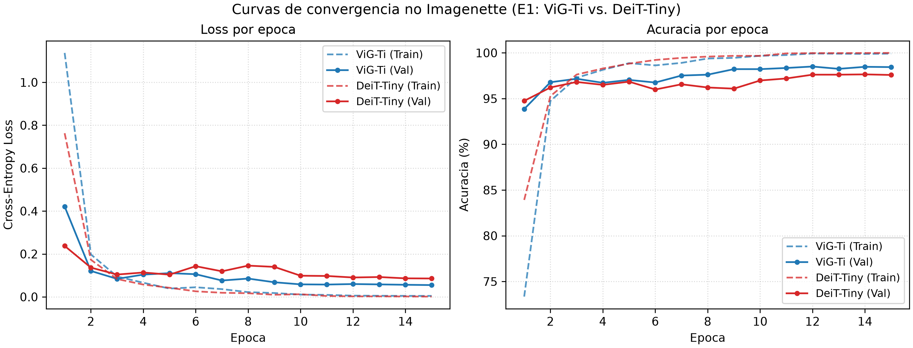

# Registro Experimental: E1 (Dados, Modelos e Fine-tuning)

## 1. Ambiente e Hardware

- Python: `3.13.12` (ambiente gerenciado com `uv`)
- PyTorch: `2.15.0+cu132` (CUDA `13.2`)
- Torchvision: `0.29.2+cu132`
- `timm`: `1.0.31`
- `scikit-learn`: `1.9.1`
- GPU: `NVIDIA GeForce RTX 4070 Laptop GPU` (8 GiB VRAM)

## 2. Preparação dos Dados (Imagenette2-160)

Script executado: [`scripts/prepare_data.py`](../../scripts/prepare_data.py) usando [`configs/default.yaml`](../../configs/default.yaml) (`seed: 42`).

- Fonte: `imagenette2-160.tgz` (10 classes do ImageNet, imagens RGB convertidas explicitamente na leitura para tratar eventuais imagens em escala de cinza).
- Divisão sem vazamento de dados ([`data/splits/`](../../data/splits/)):
  - [`train.csv`](../../data/splits/train.csv): `9.469` imagens (partição oficial de treino, com `RandomResizedCrop(224, scale=(0.8, 1.0))` e `RandomHorizontalFlip(0.5)`).
  - [`val.csv`](../../data/splits/val.csv): `3.140` imagens (`80%` estratificado da partição oficial de validação, usado para seleção de checkpoint e early stopping).
  - [`test.csv`](../../data/splits/test.csv): `785` imagens (`20%` estratificado da partição oficial de validação, mantido intacto para avaliação final).
  - [`xai_subset.csv`](../../data/splits/xai_subset.csv): `100` imagens (`10` por classe amostradas deterministicamente a partir de [`test.csv`](../../data/splits/test.csv)).
- Asserções de disjunção confirmaram interseção vazia entre `train`, `val` e `test`, e inclusão estrita de `xai_subset` em `test`.

## 3. Decisões Técnicas de Implementação

### 3.1 Adaptação da ViG-Ti ([`src/models/vendor/vig_pytorch/`](../../src/models/vendor/vig_pytorch/) e [`src/models/vig_ti.py`](../../src/models/vig_ti.py))

O código oficial `vig_pytorch` (`huawei-noah/Efficient-AI-Backbones`) foi vendorizado com patches mínimos para compatibilidade com PyTorch 2.15, `timm` 1.0.31 e NumPy 2.x, preservando integralmente os nomes de camadas e a matemática original:

- Substituição de `from timm.models.layers import DropPath` por `from timm.layers import DropPath` em [`vig.py`](../../src/models/vendor/vig_pytorch/vig.py) e [`gcn_lib/torch_vertex.py`](../../src/models/vendor/vig_pytorch/gcn_lib/torch_vertex.py).
- Substituição de `np.float` por `np.float64` em [`gcn_lib/pos_embed.py`](../../src/models/vendor/vig_pytorch/gcn_lib/pos_embed.py).
- Remoção de `load_pretrained` e `@register_model` obsoletos do `timm` e de logs de inicialização em [`vig.py`](../../src/models/vendor/vig_pytorch/vig.py).
- Carregamento do checkpoint oficial `vig_ti_74.5.pth` (73.9/74.5% ImageNet-1k) com remoção do prefixo `module.` e reinicialização apenas do cabeçalho de classificação (`prediction.4.weight`, `prediction.4.bias`) para 10 classes (`unexpected_keys == []`).

### 3.2 Padronização de Normalização e Precisão

- Ambos os modelos usam a mesma normalização ImageNet (`mean=[0.485, 0.456, 0.406]`, `std=[0.229, 0.224, 0.225]`) e redimensionamento bicúbico `224x224`, em vez de `(0.5, 0.5, 0.5)` do `default_cfg` original da ViG. Isso garante entradas e baselines idênticos para todos os métodos de XAI e perturbações; durante o fine-tuning, as camadas de BatchNorm do `Stem` da ViG-Ti adaptam-se naturalmente a essa escala.
- O treino e a avaliação foram executados em `FP32` na GPU (sem `autocast` fp16) para evitar erros de cancelamento numérico no cálculo de distâncias par-a-par (`pairwise_distance`) do grafo k-NN da ViG-Ti e manter paridade exata com a etapa de explicabilidade. Durante a validação de E2, desativou-se também `cudnn.allow_tf32` e `cuda.matmul.allow_tf32` em [`src/config.py`](../../src/config.py) (`set_seed`) e os checkpoints de E1 foram reavaliados com `--eval-only` em FP32 estrito para garantir consistência de `100/100` entre lotes `B=1` e `B=32/64`.

### 3.3 Hooks de Explicabilidade nos Wrappers ([`src/models/`](../../src/models/))

- `ViGTiWrapper`:
  - Hook em `backbone[-1]` captura o mapa espacial de nós `(B, 192, 14, 14)` com grafo de gradientes intacto para Grad-CAM.
  - Hooks em `backbone[i][0].graph_conv.dilated_knn_graph` (12 blocos) capturam as arestas dinâmicas k-NN `(2, B, 196, k_i)` (com `k` crescente de 9 a 18 nos blocos finais) para o experimento E5.
- `DeiTTinyWrapper`:
  - Hook em `blocks[-1].norm1` (e não na saída de `blocks[-1]`, pois após o último bloco apenas o token CLS segue para o cabeçalho, deixando os tokens espaciais com gradiente nulo). Dentro do hook, os 196 tokens espaciais são reorganizados para `(B, 192, 14, 14)` e reconstruídos na sequência antes da atenção final, mantendo o fluxo de gradientes ativo para Grad-CAM.
  - Quando `enable_attention_capture(True)` está ativo, `fused_attn` é desativado nos 12 blocos e os mapas pós-softmax `(B, 3, 197, 197)` são capturados em `attn_drop` com diferença numérica máxima de `8.50e-07` nos logits em relação ao `fused_attn`.

## 4. Experimento E1: Fine-tuning Controlado (ViG-Ti vs. DeiT-Tiny)

### 4.1 Protocolo de Treinamento

Mesmo protocolo para os dois modelos (`seed: 42`, dataloaders reconstruídos antes de cada treino):

- Épocas: `15` (early stopping com paciência `5` sobre `val_loss`, não acionado em nenhum dos modelos).
- Otimizador: `AdamW` (`lr: 1.0e-4`, `weight_decay: 1.0e-2`), `batch_size: 32`.
- Escalonamento de taxa de aprendizado: warmup linear de `1` época (`0.1x` para `1.0x`) seguido de `CosineAnnealingLR` até `1.0e-6`.
- Critério de seleção de checkpoint: maior `val_acc` (desempate por menor `val_loss`).

### 4.2 Resultados Consolidados

| Modelo | Params | Melhor Época | Tempo Treino | Best Val Loss | Best Val Acc | Test Loss | Test Acc | Test Macro-F1 | XAI Subset (100) |
| :--- | :---: | :---: | :---: | :---: | :---: | :---: | :---: | :---: | :---: |
| `ViG-Ti` | 6.169.994 | 12 | 814,8 s | 0,0599 | 98,50% | 0,0765 | 97,20% | 0,9720 | 97,0% (97/100) |
| `DeiT-Tiny` | 5.526.346 | 14 | 354,9 s | 0,0864 | 97,64% | 0,1133 | 96,94% | 0,9694 | 97,0% (97/100) |

Acurácia por classe no teste: [`results/metrics/e1_per_class_accuracy.csv`](../../results/metrics/e1_per_class_accuracy.csv).

### 4.3 Concordância e Erros para Análise XAI

- Conjunto de teste completo (`785` imagens): `748` ambos corretos, `15` somente `ViG-Ti` correto, `13` somente `DeiT-Tiny` correto, `9` ambos errados.
- Subconjunto fixo de XAI (`100` imagens): `96` ambos corretos, `1` somente `ViG-Ti` correto, `1` somente `DeiT-Tiny` correto, `2` ambos errados.
- Casos de erro ou discordância dentro do [`xai_subset.csv`](../../data/splits/xai_subset.csv) (registrados em [`results/metrics/e1_test_predictions.csv`](../../results/metrics/e1_test_predictions.csv)):
  - `n01440764_5690.JPEG` (`tench`): ambos erraram (`ViG-Ti` previu `gas pump`, `7`, conf `0,430`; `DeiT-Tiny` previu `French horn`, `5`, conf `0,641`).
  - `n03000684_180.JPEG` (`chain saw`): `ViG-Ti` acertou (`3`, conf `0,653`), `DeiT-Tiny` previu `French horn` (`5`, conf `0,759`).
  - `n03888257_9770.JPEG` (`parachute`): `ViG-Ti` previu `tench` (`0`, conf `0,637`), `DeiT-Tiny` acertou (`9`, conf `0,790`).
  - `n03028079_14900.JPEG` (`church`): ambos previram `gas pump` (`7`, conf `0,657` na `ViG-Ti` e `0,857` no `DeiT-Tiny`).

### 4.4 Observações

- **Paridade de desempenho e análise de erros:** a diferença no conjunto de teste é de apenas `0,26` p.p. (`97,20%` vs. `96,94%`, 2 imagens em 785) e há empate exato no [`xai_subset.csv`](../../data/splits/xai_subset.csv) (`97/100`), eliminando a acurácia como fator de confusão para E3, E4 e E5. Como há apenas 3 erros por modelo no recorte de 100 imagens, a comparação de acertos vs. erros será conduzida de forma qualitativa (estudos de caso).
- **Contagem de parâmetros vs. paper original:** no ImageNet-1k (1.000 classes), reportam-se ~7,1M (`ViG-Ti`) e ~5,7M (`DeiT-Tiny`); com o cabeçalho de 10 classes do Imagenette (`Conv2d(1024, 10, 1)` vs. `Linear(192, 10)`), os totais caem para `6,17M` e `5,53M`, deixando os dois modelos ainda mais próximos em capacidade.
- **Loss de teste e confiança nos erros:** a `ViG-Ti` obteve menor `test_loss` (`0,0765` vs. `0,1133`); o `DeiT-Tiny` atingiu `train_loss = 0,0013` e apresentou confiança mais alta nos erros do subconjunto XAI (`0,641`, `0,759`, `0,857` vs. `0,430`, `0,637`, `0,657` na `ViG-Ti`), comportamento a observar nas curvas de probabilidade do Deletion/Insertion AUC (E3).
- **Sensibilidade numérica (TF32 vs. FP32 estrito) na ViG-Ti:** desativar `cudnn.allow_tf32` e `cuda.matmul.allow_tf32` em [`src/config.py`](../../src/config.py) eliminou variações de algoritmo cuDNN entre `B=1` e `B=32` que trocavam vizinhos discretos do `topk` em `DenseDilatedKnnGraph` na `ViG-Ti`, elevando a concordância `B=1` vs. `B=32` no `xai_subset` de `98/100` para `100/100` e a acurácia de teste de `96,56%` para `97,20%`, enquanto o `DeiT-Tiny` apresentou `0` diferenças nos `785` exemplos de teste.
- **Tempo de execução na GPU:** apesar dos FLOPs equivalentes (`1,3B`), a `ViG-Ti` levou ~2,3x mais tempo por época (`814,8 s` vs. `354,9 s`), pois o `DeiT-Tiny` usa `scaled_dot_product_attention` fundido em CUDA enquanto a busca `k`-NN dinâmica e `batched_index_select` da `ViG-Ti` são limitados por largura de banda de memória. Em E2, LIME e Partition SHAP devem usar inferência em mini-batches na GPU para manter o custo viável na `ViG-Ti`.

## 5. Status Geral do Projeto

Concluído até o momento:
- Organização do repositório, dependências e configuração ([`configs/default.yaml`](../../configs/default.yaml)).
- Preparação do Imagenette2-160 e splits determinísticos sem data leakage ([`scripts/prepare_data.py`](../../scripts/prepare_data.py)).
- Adaptação da `ViG-Ti` oficial e implementação dos wrappers com hooks de ativações, grafo k-NN e atenção ([`src/models/`](../../src/models/)).
- Experimento E1 completo com checkpoints ajustados, métricas de teste e curvas de convergência ([`scripts/train.py`](../../scripts/train.py)).

Etapas pendentes:
1. E2 ([`src/xai/`](../../src/xai/), [`scripts/run_xai.py`](../../scripts/run_xai.py)): implementar Grad-CAM (ViG-Ti e DeiT-Tiny), Attention Rollout (DeiT-Tiny), LIME, Partition SHAP e Integrated Gradients; validar tempo e mapas em imagens piloto e salvar os mapas das 100 imagens em disco.
2. E3 ([`src/metrics/faithfulness.py`](../../src/metrics/faithfulness.py), [`scripts/evaluate.py`](../../scripts/evaluate.py)): calcular curvas e AUC de Deletion e Insertion (oclusão preta e desfoque gaussiano) contra baseline de saliência aleatória.
3. E4 ([`src/metrics/sanity.py`](../../src/metrics/sanity.py), [`scripts/evaluate.py`](../../scripts/evaluate.py)): executar sanity checks com aleatorização em cascata dos pesos (Spearman e SSIM).
4. E5 ([`src/metrics/graph_rewiring.py`](../../src/metrics/graph_rewiring.py), [`scripts/evaluate.py`](../../scripts/evaluate.py)): medir reconfiguração das arestas k-NN na ViG-Ti ao longo da oclusão do Deletion.
5. Ablações e análise ([`scripts/analyze.py`](../../scripts/analyze.py)): sensibilidade de hiperparâmetros (LIME `n_segments`, IG `n_steps`), testes pareados de Wilcoxon, análise acertos vs. erros e figuras qualitativas.
6. E6 opcional: teste de robustez a ruído gaussiano de entrada (se houver tempo após E2-E5).
7. Relatório final: redigir [`docs/dlnn-final/main.tex`](../dlnn-final/main.tex) com resultados, discussão e limitações.
