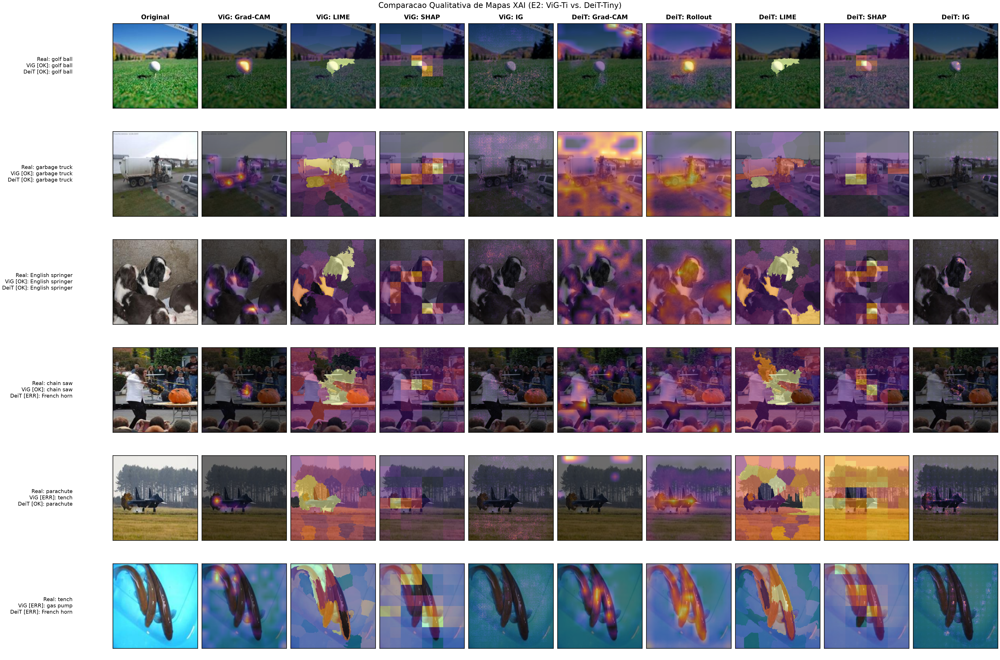

# Registro Experimental: E2 (Geração dos Mapas de Explicabilidade)

## 1. Implementação dos Explicadores ([`src/xai/`](../../src/xai/))

Todos os métodos foram executados sobre o subconjunto fixo de teste [`data/splits/xai_subset.csv`](../../data/splits/xai_subset.csv) (`N = 100` imagens, `10` por classe), explicando a classe prevista (`argmax` dos logits) por cada modelo ajustado na etapa E1.

### 1.1 Métodos Implementados e Decisões Técnicas

- **Grad-CAM** ([`src/xai/gradcam.py`](../../src/xai/gradcam.py)): aplicação simétrica na grade espacial `14x14` da última camada (`backbone[-1]` na `ViG-Ti` e `blocks[-1].norm1` no `DeiT-Tiny`), com média global dos gradientes por canal, combinação linear seguida de `ReLU` e upsampling bilinear para `224x224`.
- **Attention Rollout** ([`src/xai/rollout.py`](../../src/xai/rollout.py)): aplicável apenas ao `DeiT-Tiny` (Abnar e Zuidema, 2020). Agrega os mapas de self-attention pós-softmax dos 12 blocos com `head_fusion="mean"`, `discard_ratio=0.0` e conexão residual `0.5 * A + 0.5 * I` normalizada por linha, projetando o fluxo do token CLS aos 196 patches espaciais (`14x14` com upsampling bilinear).
- **LIME** ([`src/xai/perturbations.py`](../../src/xai/perturbations.py)): segmentação SLIC (`n_segments=50`, `compactness=10.0`, `start_label=0`), `num_samples=1000`, `hide_color=0`, `batch_size=64` e semente determinística por imagem (`seed + idx`). A função de predição recebe probabilidades softmax (`return_probs=True`) em mini-batches na GPU. O parâmetro `progress_bar` foi omitido por incompatibilidade com `lime 0.2.0.1`.
- **Partition SHAP** ([`src/xai/perturbations.py`](../../src/xai/perturbations.py)): aproximação hierárquica de valores de Shapley com `max_evals=500` e `batch_size=32`. A função de predição retorna **logits brutos** (`return_probs=False`) para evitar saturação do softmax próximo a `1,0`. Como `opencv-python` não integra o ambiente, o masker equivalente a `blur(32,32)` é construído via `scipy.ndimage.uniform_filter` (`size=(32, 32, 1)`, `mode="reflect"`) e passado como array de fundo ao `shap.maskers.Image`.
- **Integrated Gradients** ([`src/xai/ig.py`](../../src/xai/ig.py)): implementado com `captum.attr.IntegratedGradients` (`method="riemann_right"`, `n_steps=50`, `internal_batch_size=16`), correspondendo à Equação 1 da proposta. O baseline preto verdadeiro em RGB (`0, 0, 0`) é convertido para o espaço normalizado ImageNet via `(0 - mean) / std`, e as atribuições por canal são agregadas por soma dos valores absolutos (`abs().sum(dim=0)`).

### 1.2 Armazenamento em Disco ([`scripts/run_xai.py`](../../scripts/run_xai.py))

Para evitar recomputação nas etapas E3, E4 e análises qualitativas, os 9 pares modelo x método foram persistidos em arquivos compactados `.npz` em `results/maps/` (ignorados pelo git), contendo:

- `maps`: array `(100, 224, 224)` em `float32` normalizado para `[0, 1]` via min-max por imagem (`normalize_map`).
- `raw_maps`: array `(100, 224, 224)` em `float32` pré-normalização, preservando sinais negativos e positivos de LIME e Partition SHAP.
- Metadados alinhados por índice: `target_classes`, `true_labels`, `pred_probs`, `image_paths` e `elapsed_sec`.

## 2. Determinismo FP32 Estrito e Alinhamento com E1

Durante o início da execução completa de E2, a verificação automática detectou divergência de predição na `ViG-Ti` em `1` imagem limítrofe (`n03000684_14132.JPEG`, `99/100`) entre a avaliação em lote de E1 (`batch_size=32`) e a inferência unitária em E2 (`batch_size=1`), enquanto o `DeiT-Tiny` manteve `100/100` (e `785/785` no teste).

O diagnóstico mostrou que `torch.backends.cudnn.allow_tf32` inicia como `True` no PyTorch 2.15: convoluções em TF32 (mantissa de 10 bits) variam conforme o tamanho do lote, gerando pequenas diferenças no `Stem` da `ViG-Ti` amplificadas pelo `BatchNorm2d`, suficientes para inverter vizinhos discretos no `torch.topk` de `DenseDilatedKnnGraph` ao longo dos 12 blocos.

A desativação explícita de `cudnn.allow_tf32` e `cuda.matmul.allow_tf32` em [`src/config.py`](../../src/config.py) (`set_seed`) e a reavaliação dos checkpoints de E1 via `--eval-only` eliminaram completamente a dependência de tamanho de lote (`100/100` entre `B=1`, `B=32` e `B=64` nos dois modelos), alinhando todas as predições de E2 com E1 em `100/100` nos 9 pares.

## 3. Tempos de Execução e Validação Quantitativa (`N = 100`)

Resumo extraído de [`results/metrics/e2_xai_summary.json`](../../results/metrics/e2_xai_summary.json) (GPU `NVIDIA GeForce RTX 4070 Laptop GPU`, FP32 estrito, `seed: 42`):

| Modelo | Método | Imagens | Tempo Total | Média (s/img) | Desvio (s) | Mapas Válidos | Match E1 | Média do Mapa |
| :--- | :--- | :---: | :---: | :---: | :---: | :---: | :---: | :---: |
| `ViG-Ti` | `gradcam` | 100 | 2,04 s | 0,020 | 0,027 | 100/100 | 100/100 | 0,0427 |
| `ViG-Ti` | `lime` | 100 | 372,02 s | 3,720 | 0,206 | 100/100 | 100/100 | 0,3484 |
| `ViG-Ti` | `partition_shap` | 100 | 161,49 s | 1,615 | 0,009 | 100/100 | 100/100 | 0,2291 |
| `ViG-Ti` | `integrated_gradients` | 100 | 22,03 s | 0,220 | 0,002 | 100/100 | 100/100 | 0,0584 |
| `DeiT-Tiny` | `gradcam` | 100 | 0,83 s | 0,008 | 0,001 | 100/100 | 100/100 | 0,2645 |
| `DeiT-Tiny` | `rollout` | 100 | 0,56 s | 0,006 | 0,001 | 100/100 | 100/100 | 0,2844 |
| `DeiT-Tiny` | `lime` | 100 | 216,92 s | 2,169 | 0,154 | 100/100 | 100/100 | 0,3620 |
| `DeiT-Tiny` | `partition_shap` | 100 | 89,18 s | 0,892 | 0,035 | 100/100 | 100/100 | 0,2631 |
| `DeiT-Tiny` | `integrated_gradients` | 100 | 11,82 s | 0,118 | 0,003 | 100/100 | 100/100 | 0,0292 |

Tempo acumulado dos 9 pares: `876,89 s` (`14,6 min`). Todos os mapas apresentaram valores finitos em `[0, 1]` e norma positiva.

## 4. Inspeção Qualitativa

Observações diretas sobre os 6 casos representativos em [`results/figures/e2_qualitative_grid.pdf`](../../results/figures/e2_qualitative_grid.pdf):

- **Grad-CAM (`ViG-Ti` vs. `DeiT-Tiny`):** na `ViG-Ti`, o Grad-CAM em nós concentra-se de forma compacta sobre o objeto-alvo (ex.: bola de golfe, caminhão, lâmina da motosserra no caso `chain saw` em que apenas a `ViG-Ti` acertou). No `DeiT-Tiny`, o Grad-CAM sobre `blocks[-1].norm1` ativa com frequência patches de borda e fundo (padrão consistente com tokens de registro/alta norma em ViTs sem register tokens), enquanto o Attention Rollout concentra o foco no objeto central.
- **LIME e Partition SHAP:** ambos produzem regiões espaciais coerentes com os objetos principais em `golf ball`, `garbage truck`, `English springer` e `chain saw`. Em `parachute`, o `Partition SHAP` no `DeiT-Tiny` atribui peso alto também ao céu/pista ao redor da aeronave com paraquedas.
- **Integrated Gradients:** produz atribuições esparsas em nível de pixel com picos isolados elevados, resultando em média normalizada baixa (`0,0584` na `ViG-Ti` e `0,0292` no `DeiT-Tiny`) concentrada nos contornos do objeto principal. O efeito dessa esparsidade sobre o ranqueamento de pixels será avaliado quantitativamente em E3.

## 5. Status Geral do Projeto

Concluído até o momento:
- Organização do repositório, configuração ([`configs/default.yaml`](../../configs/default.yaml)) e determinismo FP32 estrito ([`src/config.py`](../../src/config.py)).
- Preparação do Imagenette2-160 e splits sem data leakage ([`scripts/prepare_data.py`](../../scripts/prepare_data.py)).
- Wrappers `ViG-Ti` e `DeiT-Tiny` com hooks prontos ([`src/models/`](../../src/models/)).
- Experimento E1: fine-tuning controlado e avaliação em FP32 estrito ([`scripts/train.py`](../../scripts/train.py)).
- Experimento E2: implementação dos 5 métodos XAI e geração dos mapas nas 100 imagens ([`src/xai/`](../../src/xai/), [`scripts/run_xai.py`](../../scripts/run_xai.py)).

Etapas pendentes:
1. E3 ([`src/metrics/faithfulness.py`](../../src/metrics/faithfulness.py), [`scripts/evaluate.py`](../../scripts/evaluate.py)): curvas e AUC de Deletion e Insertion (oclusão preta e desfoque gaussiano) + baseline aleatório.
2. E4 ([`src/metrics/sanity.py`](../../src/metrics/sanity.py), [`scripts/evaluate.py`](../../scripts/evaluate.py)): sanity checks com aleatorização em cascata dos pesos (Spearman e SSIM).
3. E5 ([`src/metrics/graph_rewiring.py`](../../src/metrics/graph_rewiring.py), [`scripts/evaluate.py`](../../scripts/evaluate.py)): medição de reconfiguração das arestas k-NN na `ViG-Ti` sob Deletion.
4. Ablações e análise ([`scripts/analyze.py`](../../scripts/analyze.py)): sensibilidade de hiperparâmetros (`n_segments` no LIME, `n_steps` no IG), testes pareados de Wilcoxon, comparação acertos vs. erros e figuras finais.
5. E6 opcional: teste de robustez a ruído gaussiano de entrada.
6. Relatório final: redigir [`docs/dlnn-final/main.tex`](../dlnn-final/main.tex) com resultados, discussão e limitações.
