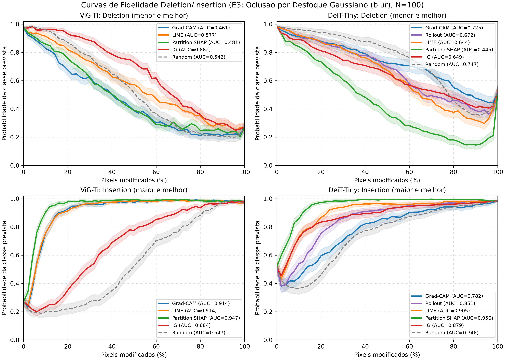
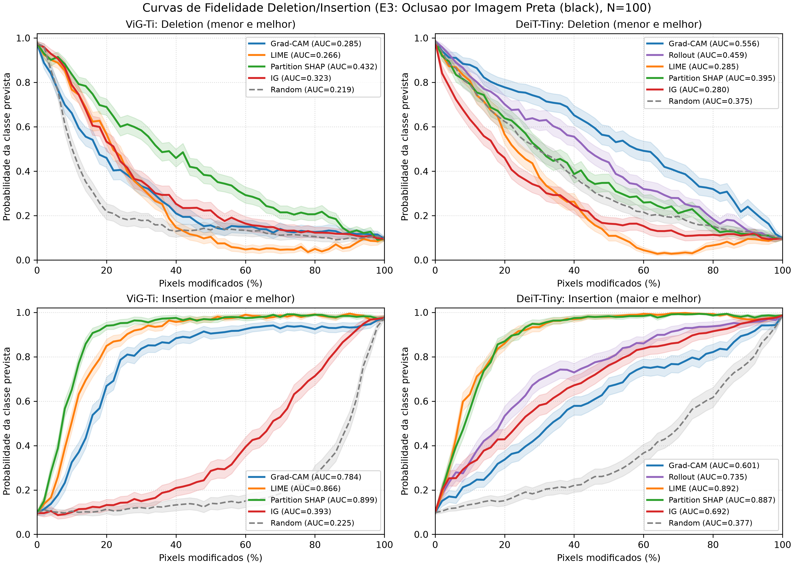
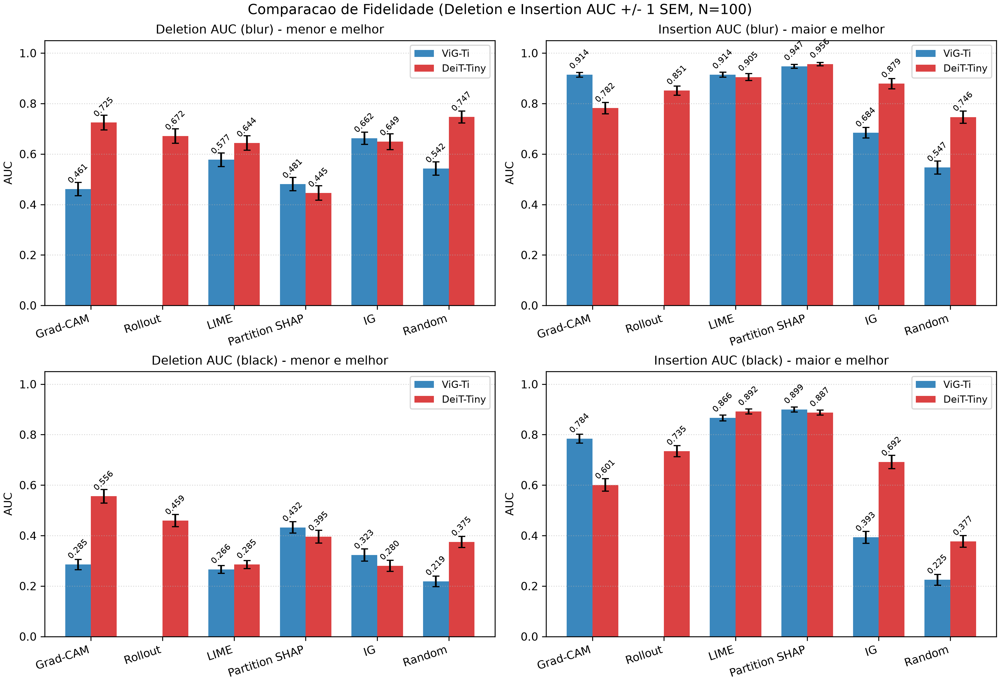

# Registro Experimental: E3 (Avaliação de Fidelidade via Deletion e Insertion AUC)

## 1. Protocolo Implementado ([`src/metrics/faithfulness.py`](../../src/metrics/faithfulness.py) e [`scripts/evaluate.py`](../../scripts/evaluate.py))

A avaliação quantitativa de fidelidade (Petsiuk et al., 2018) foi executada sobre as `N = 100` imagens fixas de [`data/splits/xai_subset.csv`](../../data/splits/xai_subset.csv), utilizando os mapas normalizados salvos em `results/maps/` e os checkpoints em FP32 estrito (`allow_tf32=False`, `seed: 42`).

- **Grade de perturbação:** `50` passos (`51` pontos de `0%` a `100%` dos `224 x 224 = 50.176` pixels), integrados pela regra trapezoidal (`np.trapezoid`).
- **Baselines de oclusão (em espaço RGB `[0, 1]` antes da normalização ImageNet):**
  - `black`: imagem preta (`0, 0, 0`).
  - `blur`: desfoque gaussiano (`kernel_size=21`, `sigma=10.0`) via `torchvision.transforms.functional.gaussian_blur`, mitigando bordas artificiais fora da distribuição.
- **Ordenação de pixels e desempate:** ordenação decrescente via `np.lexsort` com desempate aleatório determinístico (`seed + idx`) para evitar viés de varredura espacial em platôs de superpixels (LIME), blocos (Partition SHAP) ou zeros de ReLU (Grad-CAM).
- **Controle negativo:** mapa uniforme aleatório (`random`) gerado por imagem com `seed + idx`, avaliado para os mesmos `target_classes` e curvas.
- **Invariantes verificados:** checagem automática de contorno (`|del[0] - ins[-1]| < 1e-4` e `|del[-1] - ins[0]| < 1e-4`) e aderência exata às probabilidades de E1 (`|orig_prob - e1_conf| < 1e-3`) em todas as `2.200` avaliações.

## 2. Resultados Consolidados (Deletion e Insertion AUC)

- **Deletion AUC:** menor é melhor (queda rápida da probabilidade prevista ao remover pixels tidos como relevantes).
- **Insertion AUC:** maior é melhor (recuperação rápida da probabilidade ao inserir pixels relevantes sobre o baseline).

### 2.1 Oclusão por Desfoque Gaussiano (`blur`)

| Modelo | Método | Deletion AUC (Média +/- DP) | Deletion Mediana | Insertion AUC (Média +/- DP) | Insertion Mediana | Diff (Ins - Del) |
| :--- | :--- | :---: | :---: | :---: | :---: | :---: |
| `ViG-Ti` | `gradcam` | **0,4611** +/- 0,2626 | 0,4489 | 0,9141 +/- 0,0952 | 0,9413 | +0,4529 |
| `ViG-Ti` | `lime` | 0,5772 +/- 0,2685 | 0,6109 | 0,9140 +/- 0,0984 | 0,9453 | +0,3368 |
| `ViG-Ti` | `partition_shap` | 0,4806 +/- 0,2651 | 0,4607 | **0,9469** +/- 0,0766 | 0,9684 | **+0,4663** |
| `ViG-Ti` | `integrated_gradients` | 0,6622 +/- 0,2408 | 0,6667 | 0,6842 +/- 0,2078 | 0,7074 | +0,0220 |
| `ViG-Ti` | `random` | 0,5421 +/- 0,2651 | 0,5228 | 0,5467 +/- 0,2565 | 0,5290 | +0,0045 |
| `DeiT-Tiny` | `gradcam` | 0,7248 +/- 0,2917 | 0,8277 | 0,7819 +/- 0,2213 | 0,8582 | +0,0571 |
| `DeiT-Tiny` | `rollout` | 0,6716 +/- 0,2859 | 0,6954 | 0,8515 +/- 0,1830 | 0,9174 | +0,1798 |
| `DeiT-Tiny` | `lime` | 0,6441 +/- 0,2875 | 0,6637 | 0,9050 +/- 0,1424 | 0,9561 | +0,2609 |
| `DeiT-Tiny` | `partition_shap` | **0,4453** +/- 0,2867 | 0,4223 | **0,9565** +/- 0,0651 | 0,9891 | **+0,5112** |
| `DeiT-Tiny` | `integrated_gradients` | 0,6489 +/- 0,3108 | 0,7002 | 0,8787 +/- 0,2045 | 0,9560 | +0,2297 |
| `DeiT-Tiny` | `random` | 0,7467 +/- 0,2404 | 0,7766 | 0,7461 +/- 0,2416 | 0,7895 | -0,0006 |

### 2.2 Oclusão por Imagem Preta (`black`)

| Modelo | Método | Deletion AUC (Média +/- DP) | Deletion Mediana | Insertion AUC (Média +/- DP) | Insertion Mediana | Diff (Ins - Del) |
| :--- | :--- | :---: | :---: | :---: | :---: | :---: |
| `ViG-Ti` | `gradcam` | 0,2851 +/- 0,2076 | 0,2229 | 0,7840 +/- 0,1766 | 0,8300 | +0,4989 |
| `ViG-Ti` | `lime` | **0,2657** +/- 0,1579 | 0,2504 | 0,8662 +/- 0,1142 | 0,8951 | **+0,6005** |
| `ViG-Ti` | `partition_shap` | 0,4322 +/- 0,2287 | 0,3892 | **0,8994** +/- 0,0985 | 0,9180 | +0,4671 |
| `ViG-Ti` | `integrated_gradients` | 0,3233 +/- 0,2418 | 0,2477 | 0,3932 +/- 0,2369 | 0,3452 | +0,0699 |
| `ViG-Ti` | `random` | 0,2185 +/- 0,2116 | 0,1400 | 0,2246 +/- 0,2127 | 0,1471 | +0,0061 |
| `DeiT-Tiny` | `gradcam` | 0,5558 +/- 0,2701 | 0,6033 | 0,6007 +/- 0,2510 | 0,6446 | +0,0449 |
| `DeiT-Tiny` | `rollout` | 0,4594 +/- 0,2386 | 0,4772 | 0,7346 +/- 0,2197 | 0,7964 | +0,2751 |
| `DeiT-Tiny` | `lime` | 0,2852 +/- 0,1605 | 0,2684 | **0,8917** +/- 0,0987 | 0,9187 | **+0,6065** |
| `DeiT-Tiny` | `partition_shap` | 0,3952 +/- 0,2539 | 0,3516 | 0,8875 +/- 0,0941 | 0,9129 | +0,4923 |
| `DeiT-Tiny` | `integrated_gradients` | **0,2800** +/- 0,2194 | 0,2413 | 0,6917 +/- 0,2606 | 0,7656 | +0,4117 |
| `DeiT-Tiny` | `random` | 0,3747 +/- 0,2205 | 0,3621 | 0,3770 +/- 0,2319 | 0,3525 | +0,0022 |

## 3. Testes Pareados de Wilcoxon (`N = 100`)

Resumo das comparações principais extraídas de [`results/metrics/e3_wilcoxon_tests.csv`](../../results/metrics/e3_wilcoxon_tests.csv):

| Grupo | Comparação (A vs. B) | Baseline | Métrica | Média A vs. B | p-valor | Signif. (`p < 0,05`) |
| :--- | :--- | :---: | :---: | :---: | :---: | :---: |
| `vig_vs_deit` | `vig_ti/gradcam` vs. `deit_tiny/gradcam` | `blur` | Deletion | 0,461 vs. 0,725 | `8,89e-11` | Sim |
| `vig_vs_deit` | `vig_ti/gradcam` vs. `deit_tiny/gradcam` | `blur` | Insertion | 0,914 vs. 0,782 | `2,65e-09` | Sim |
| `vig_vs_deit` | `vig_ti/gradcam` vs. `deit_tiny/gradcam` | `black` | Deletion | 0,285 vs. 0,556 | `9,44e-12` | Sim |
| `vig_vs_deit` | `vig_ti/gradcam` vs. `deit_tiny/gradcam` | `black` | Insertion | 0,784 vs. 0,601 | `3,27e-10` | Sim |
| `vig_vs_deit_nat` | `vig_ti/gradcam` vs. `deit_tiny/rollout` | `blur` | Deletion | 0,461 vs. 0,672 | `1,08e-08` | Sim |
| `vig_vs_deit_nat` | `vig_ti/gradcam` vs. `deit_tiny/rollout` | `blur` | Insertion | 0,914 vs. 0,851 | `6,10e-05` | Sim |
| `vig_vs_deit_nat` | `vig_ti/gradcam` vs. `deit_tiny/rollout` | `black` | Deletion | 0,285 vs. 0,459 | `7,07e-11` | Sim |
| `vig_vs_deit_nat` | `vig_ti/gradcam` vs. `deit_tiny/rollout` | `black` | Insertion | 0,784 vs. 0,735 | `8,53e-03` | Sim |
| `deit_native` | `deit_tiny/gradcam` vs. `deit_tiny/rollout` | `blur` | Insertion | 0,782 vs. 0,851 | `1,21e-03` | Sim |
| `deit_native` | `deit_tiny/gradcam` vs. `deit_tiny/rollout` | `black` | Deletion | 0,556 vs. 0,459 | `3,54e-04` | Sim |
| `deit_native` | `deit_tiny/gradcam` vs. `deit_tiny/rollout` | `black` | Insertion | 0,601 vs. 0,735 | `1,67e-05` | Sim |
| `vig_vs_deit` | `vig_ti/lime` vs. `deit_tiny/lime` | `blur` | Deletion | 0,577 vs. 0,644 | `1,73e-03` | Sim |
| `vig_vs_deit` | `vig_ti/lime` vs. `deit_tiny/lime` | `black` | Insertion | 0,866 vs. 0,892 | `3,63e-04` | Sim |
| `vig_vs_deit` | `vig_ti/partition_shap` vs. `deit_tiny/partition_shap` | `blur` | Deletion | 0,481 vs. 0,445 | `0,1122` | Não |
| `vig_vs_deit` | `vig_ti/partition_shap` vs. `deit_tiny/partition_shap` | `blur` | Insertion | 0,947 vs. 0,956 | `0,0205` | Sim |
| `vig_vs_deit` | `vig_ti/partition_shap` vs. `deit_tiny/partition_shap` | `black` | Deletion | 0,432 vs. 0,395 | `0,0288` | Sim |
| `vig_vs_deit` | `vig_ti/partition_shap` vs. `deit_tiny/partition_shap` | `black` | Insertion | 0,899 vs. 0,887 | `0,2209` | Não |
| `vig_vs_deit` | `vig_ti/integrated_gradients` vs. `deit_tiny/integrated_gradients` | `blur` | Insertion | 0,684 vs. 0,879 | `1,22e-10` | Sim |
| `vig_vs_deit` | `vig_ti/integrated_gradients` vs. `deit_tiny/integrated_gradients` | `black` | Insertion | 0,393 vs. 0,692 | `1,04e-15` | Sim |

## 4. Observações Principais

- **Efeito da oclusão `black` vs. `blur` e artefato OOD na `ViG-Ti`:** sob substituição por preto (`black`), o controle aleatório (`random`) na `ViG-Ti` derruba a probabilidade de `0,975` para ~`0,22` já com `20%` de pixels apagados (`Deletion AUC = 0,2185`), superando todos os explicadores reais em `Deletion (black)` (`p < 2e-4`). Pixels pretos dispersos uniformemente introduzem ruído de alta frequência fora da distribuição que degrada rapidamente as convoluções 3x3 do `Stem` e as distâncias k-NN, enquanto explicadores estruturados concentram a remoção em regiões contíguas. Sob `Insertion (black)` e sob `blur` (que remove o ruído de alta frequência), os explicadores reais recuperam vantagem ampla sobre `random` (`Partition SHAP`, `Grad-CAM` e `LIME` atingem `Insertion AUC > 0,91` com `blur`, `p < 1e-13`).
- **Vantagem expressiva do Grad-CAM na `ViG-Ti` frente ao `DeiT-Tiny`:** tanto contra `DeiT-Tiny Grad-CAM` (`p < 3e-9` em todas as 4 métricas) quanto contra `DeiT-Tiny Attention Rollout` (`p <= 0,0085` em todas as 4 métricas), o Grad-CAM sobre nós `14x14` da `ViG-Ti` é substancialmente mais fiel. Além disso, `DeiT-Tiny Rollout` supera `DeiT-Tiny Grad-CAM` em `Insertion (blur/black)` e `Deletion (black)` (`p <= 0,0012`), confirmando quantitativamente que tokens de fundo/borda com alta norma degradam o Grad-CAM em `blocks[-1].norm1` no ViT.
- **Inversão no Integrated Gradients (IG):** na métrica de `Insertion`, o `DeiT-Tiny` supera drasticamente a `ViG-Ti` (`0,879` vs. `0,684` em `blur`, `p = 1,22e-10`; `0,692` vs. `0,393` em `black`, `p = 1,04e-15`). Como o IG gera atribuições esparsas em nível de pixel, inserir pixels isolados dentro de patches `16x16` já ativa projeções lineares por patch no `DeiT-Tiny`, ao passo que o `Stem` convolucional com `BatchNorm2d` da `ViG-Ti` responde mal a pixels esparsos isolados sobre fundo uniforme.
- **Consistência dos métodos agnósticos:** `Partition SHAP` obtém os maiores `Insertion AUC` globais em ambos os backbones (`0,947` na `ViG-Ti` e `0,956` no `DeiT-Tiny` com `blur`), além do menor `Deletion AUC (blur)` no `DeiT-Tiny` (`0,445`).
- **Base residual para `DeiT-Tiny` com `blur`:** a probabilidade média sobre a imagem totalmente borrada é maior no `DeiT-Tiny` (`0,517` vs. `0,271` na `ViG-Ti`), indicando maior retenção de pistas globais de baixa frequência pelo self-attention denso.

## 5. Artefatos Gerados e Status Geral do Projeto

Artefatos salvos por E3:
- [`results/metrics/e3_faithfulness_per_image.csv`](../../results/metrics/e3_faithfulness_per_image.csv) (`2.200` linhas)
- [`results/metrics/e3_faithfulness_curves.csv`](../../results/metrics/e3_faithfulness_curves.csv) (`1.122` linhas)
- [`results/metrics/e3_faithfulness_summary.csv`](../../results/metrics/e3_faithfulness_summary.csv) e [`e3_faithfulness_summary.json`](../../results/metrics/e3_faithfulness_summary.json)
- [`results/metrics/e3_wilcoxon_tests.csv`](../../results/metrics/e3_wilcoxon_tests.csv) (`60` comparações pareadas)
- Figuras em PDF e PNG: `e3_curves_blur`, `e3_curves_black` e `e3_auc_comparison` em [`results/figures/`](../../results/figures/)

Concluído até o momento:
- Preparação de dados e splits (`scripts/prepare_data.py`).
- E1: fine-tuning controlado e avaliação em FP32 estrito (`scripts/train.py`).
- E2: geração e persistência dos mapas de 5 famílias de XAI (`scripts/run_xai.py`).
- E3: avaliação de fidelidade Deletion/Insertion AUC (`blur` e `black`), baseline aleatório e testes de Wilcoxon (`scripts/evaluate.py --experiment e3`).

Etapas pendentes:
1. E4 ([`src/metrics/sanity.py`](../../src/metrics/sanity.py), [`scripts/evaluate.py`](../../scripts/evaluate.py)): sanity checks por aleatorização em cascata dos parâmetros (Spearman e SSIM).
2. E5 ([`src/metrics/graph_rewiring.py`](../../src/metrics/graph_rewiring.py), [`scripts/evaluate.py`](../../scripts/evaluate.py)): análise estrutural de reconfiguração das arestas k-NN na `ViG-Ti` sob Deletion.
3. Ablações e análise consolidada ([`scripts/analyze.py`](../../scripts/analyze.py)): ablações de LIME (`n_segments`) e IG (`n_steps`), estudos de caso acertos vs. erros e figuras finais.
4. E6 opcional: teste de robustez a ruído gaussiano de entrada.
5. Relatório final: redigir [`docs/dlnn-final/main.tex`](../dlnn-final/main.tex) com resultados, discussão e limitações.
