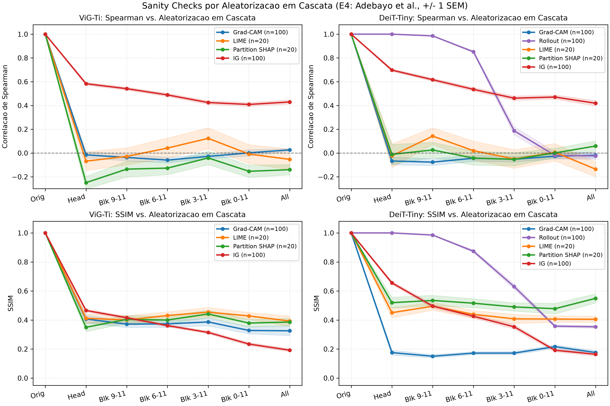

# Registro Experimental: E4 (Sanity Checks por Aleatorização em Cascata)

## 1. Protocolo Implementado ([`src/metrics/sanity.py`](../../src/metrics/sanity.py) e [`scripts/evaluate.py`](../../scripts/evaluate.py))

Seguindo Adebayo et al. (2018), avaliou-se a sensibilidade dos explicadores aos parâmetros aprendidos por meio de aleatorização em cascata (do cabeçalho de classificação em direção à entrada) sobre os checkpoints em FP32 estrito (`seed: 42`).

- **Estágios cumulativos (7 pontos):**
  - `original` (estágio 0): mapas de referência da etapa E2.
  - `head` (estágio 1): reinicialização de `prediction` (`ViG-Ti`) ou `head + norm` (`DeiT-Tiny`).
  - `blocks_9_11` (estágio 2): adição dos blocos `9..11`.
  - `blocks_6_11` (estágio 3): adição dos blocos `6..8`.
  - `blocks_3_11` (estágio 4): adição dos blocos `3..5`.
  - `blocks_0_11` (estágio 5): adição dos blocos `0..2`.
  - `all_layers` (estágio 6): adição de `stem + pos_embed` (`ViG-Ti`) ou `patch_embed + pos_embed + cls_token` (`DeiT-Tiny`).
- **Amostragem e hiperparâmetros:**
  - `gradcam`, `rollout` e `integrated_gradients`: todas as `N = 100` imagens de [`data/splits/xai_subset.csv`](../../data/splits/xai_subset.csv).
  - `lime` e `partition_shap`: subamostra estratificada determinística de `N = 20` imagens (`2` por classe, [`configs/default.yaml`](../../configs/default.yaml)) mantendo os mesmos hiperparâmetros de E2 (`num_samples=1000`, `max_evals=500`).
- **Alvo e métricas:** classe-alvo fixada na predição original de E2 (`target_classes`). Comparou-se cada mapa gerado pós-aleatorização ao mapa original via correlação de postos de Spearman (`spearman`) e SSIM (`data_range=1,0`), contabilizando mapas constantes (`std < 1e-12`, tratados com `spearman = 0,0`).

## 2. Resultados Consolidados (Estágios Chave)

Resumo extraído de [`results/metrics/e4_sanity_summary.csv`](../../results/metrics/e4_sanity_summary.csv) (`N = 100` para Grad-CAM/Rollout/IG; `N = 20` para LIME/Partition SHAP; tempo total `1.426,64 s` / `23,8 min`):

| Modelo | Método | `head` (Spearman / SSIM) | `blocks_6_11` (Spearman / SSIM) | `blocks_3_11` (Spearman / SSIM) | `all_layers` (Spearman / SSIM) | Mapas Constantes (`all_layers`) |
| :--- | :--- | :---: | :---: | :---: | :---: | :---: |
| `ViG-Ti` | `gradcam` | -0,015 / 0,407 | -0,059 / 0,374 | -0,028 / 0,387 | **0,027** / 0,326 | 21/100 |
| `ViG-Ti` | `lime` | -0,068 / 0,412 | 0,042 / 0,431 | 0,123 / 0,454 | -0,053 / 0,393 | 0/20 |
| `ViG-Ti` | `partition_shap` | -0,249 / 0,350 | -0,127 / 0,400 | -0,041 / 0,442 | -0,140 / 0,386 | 0/20 |
| `ViG-Ti` | `integrated_gradients` | 0,583 / 0,466 | 0,489 / 0,362 | 0,425 / 0,314 | 0,430 / **0,192** | 0/100 |
| `DeiT-Tiny` | `gradcam` | -0,067 / **0,175** | -0,044 / **0,172** | -0,052 / **0,172** | -0,019 / **0,176** | 7/100 |
| `DeiT-Tiny` | `rollout` | 1,000 / 1,000 | 0,852 / 0,874 | 0,187 / 0,630 | -0,024 / 0,353 | 0/100 |
| `DeiT-Tiny` | `lime` | -0,023 / 0,451 | 0,020 / 0,439 | -0,049 / 0,408 | -0,136 / 0,405 | 0/20 |
| `DeiT-Tiny` | `partition_shap` | -0,011 / 0,520 | -0,042 / 0,516 | -0,053 / 0,490 | 0,059 / 0,549 | 0/20 |
| `DeiT-Tiny` | `integrated_gradients` | 0,698 / 0,656 | 0,536 / 0,426 | 0,461 / 0,353 | 0,419 / **0,164** | 0/100 |

## 3. Testes Pareados de Wilcoxon (`head` e `all_layers`)

Extraído de [`results/metrics/e4_wilcoxon_tests.csv`](../../results/metrics/e4_wilcoxon_tests.csv):

- **DeiT Grad-CAM vs. DeiT Rollout em `head`:** diferença altamente significativa em Spearman (`-0,067` vs. `1,000`, `p = 3,90e-18`) e SSIM (`0,175` vs. `1,000`, `p = 3,90e-18`); em `all_layers`, ambos colapsam em Spearman (`-0,019` vs. `-0,024`, `p = 0,921`).
- **ViG-Ti vs. DeiT-Tiny em `head`:**
  - `gradcam`: Spearman equivalente (`-0,015` vs. `-0,067`, `p = 0,267`), SSIM menor no `DeiT-Tiny` (`0,407` vs. `0,175`, `p = 9,94e-09`).
  - `integrated_gradients`: retenção maior no `DeiT-Tiny` em `head` (Spearman `0,698` vs. `0,583`, `p = 5,18e-17`; SSIM `0,656` vs. `0,466`, `p = 5,99e-17`).
- **ViG-Ti vs. DeiT-Tiny em `all_layers`:**
  - `gradcam`: Spearman próximo de zero nos dois modelos (`0,027` vs. `-0,019`, `p = 0,127`).
  - `integrated_gradients`: Spearman residual equivalente (`0,430` vs. `0,419`, `p = 0,652`), com SSIM menor no `DeiT-Tiny` (`0,164` vs. `0,192`, `p = 4,22e-05`).
  - `lime`: Spearman e SSIM equivalentes nos dois modelos (`p = 0,312` e `p = 0,985`).

## 4. Observações Principais

- **Sensibilidade imediata de Grad-CAM, LIME e Partition SHAP:** nos dois modelos, os três métodos caem imediatamente para Spearman próximo de zero já no estágio `head`, demonstrando dependência estrita dos pesos aprendidos da tarefa.
- **Invariância estrutural do Attention Rollout ao cabeçalho e blocos finais:** no `DeiT-Tiny`, o Attention Rollout permanece inalterado em `head` (`1,000 / 1,000`) e quase invariante até `blocks_9_11` (`0,986 / 0,985`), começando a cair de forma relevante apenas a partir de `blocks_6_11` (`0,852`) e colapsando em `blocks_3_11` (`0,187`) e `blocks_0_11` (`-0,020`). Isso decorre diretamente de sua formulação agnóstica à classe e ao cabeçalho linear.
- **Persistência de bordas no Integrated Gradients (efeito Adebayo et al.):** mesmo após aleatorizar todas as camadas (`all_layers`), o IG retém correlação de postos positiva elevada (`Spearman = 0,430` na `ViG-Ti` e `0,419` no `DeiT-Tiny`), embora o SSIM caia continuamente até `0,192` e `0,164`. A multiplicação `(x - x_black)` no cálculo do IG preserva a estrutura de contraste da imagem de entrada independentemente dos pesos da rede.
- **Efeito de mapas constantes no SSIM do Grad-CAM:** na `ViG-Ti`, `10/100` (`head`) a `21/100` (`all_layers`) mapas pós-ReLU tornam-se nulos; como os mapas originais de Grad-CAM da `ViG-Ti` são esparsos e localizados, o SSIM com um mapa nulo mantém valor médio intermediário (`0,326` vs. `0,176` no `DeiT-Tiny`), reforçando a importância de avaliar Spearman e SSIM em conjunto.

## 5. Artefatos Gerados e Status Geral do Projeto

Artefatos salvos por E4:
- [`results/metrics/e4_sanity_per_image.csv`](../../results/metrics/e4_sanity_per_image.csv) (`4.060` linhas)
- [`results/metrics/e4_sanity_summary.csv`](../../results/metrics/e4_sanity_summary.csv) (`63` linhas) e [`e4_sanity_summary.json`](../../results/metrics/e4_sanity_summary.json)
- [`results/metrics/e4_wilcoxon_tests.csv`](../../results/metrics/e4_wilcoxon_tests.csv) (`20` comparações)
- Figura [`results/figures/e4_sanity_curves.pdf`](../../results/figures/e4_sanity_curves.pdf) (e `.png`)

Concluído até o momento:
- Preparação de dados e splits (`scripts/prepare_data.py`).
- E1: fine-tuning controlado e avaliação em FP32 estrito (`scripts/train.py`).
- E2: geração dos mapas de 5 famílias de XAI (`scripts/run_xai.py`).
- E3: fidelidade Deletion/Insertion AUC (`blur` e `black`), baseline aleatório e testes de Wilcoxon (`scripts/evaluate.py --experiment e3`).
- E4: sanity checks em cascata (`scripts/evaluate.py --experiment e4`).
- E5: análise de graph rewiring `k`-NN na `ViG-Ti` (`scripts/evaluate.py --experiment e5`).

Etapas pendentes:
1. Ablações e análise consolidada ([`scripts/analyze.py`](../../scripts/analyze.py)): sensibilidade de `n_segments` (LIME) e `n_steps` (IG) em subconjunto, análise acertos vs. erros e casos em que plausibilidade visual diverge do AUC.
2. E6 opcional: teste de robustez a ruído gaussiano na entrada.
3. Relatório final: redigir [`docs/dlnn-final/main.tex`](../dlnn-final/main.tex) (4 a 6 páginas).
