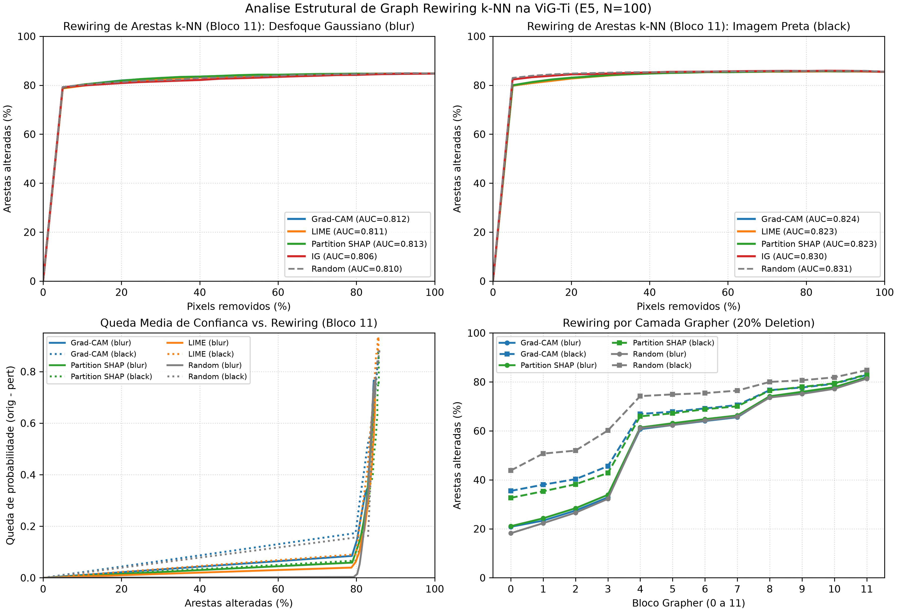

# Registro Experimental: E5 (Análise de Graph Rewiring k-NN na ViG-Ti)

## 1. Protocolo Implementado ([`src/metrics/graph_rewiring.py`](../../src/metrics/graph_rewiring.py) e [`scripts/evaluate.py`](../../scripts/evaluate.py))

O experimento E5 investiga como a oclusão progressiva de pixels durante o teste de Deletion altera a topologia dinâmica dos grafos k-NN construídos pelas camadas *Grapher* da `ViG-Ti`.

- **Amostra e baselines:** avaliação sobre todas as `N = 100` imagens de [`data/splits/xai_subset.csv`](../../data/splits/xai_subset.csv) em `20` passos (`21` pontos de `0%` a `100%` dos pixels), para os baselines `blur` (`21x21`, `sigma=10,0`) e `black`, comparando os `4` explicadores aplicáveis à `ViG-Ti` (`gradcam`, `lime`, `partition_shap`, `integrated_gradients`) contra `random`.
- **Métricas topológicas por nó (`196` nós por imagem):**
  - `retention`: fração média de vizinhos originais preservados em cada nó.
  - `rewiring`: `1 - retention` (fração de arestas alteradas em relação ao grafo da imagem intacta).
  - `jaccard_dist`: distância média de Jaccard entre os conjuntos de vizinhos originais e perturbados por nó.
- **Captura:** camada alvo padrão `target_layer = -1` (Bloco Grapher `11`, `k = 18`, `dilation = 3`) em todos os `21` pontos, mais perfil completo nos `12` blocos *Grapher* (`0` a `11`) em `20%` e `50%` de remoção.
- **Invariantes:** verificado automaticamente que `retention[0] = 1,0`, `rewiring[0] = 0,0` e `jaccard_dist[0] = 0,0` em todas as `1.000` avaliações.

## 2. Resultados Consolidados (Bloco 11 e Correlação com Queda de Confiança)

Resumo extraído de [`results/metrics/e5_rewiring_summary.csv`](../../results/metrics/e5_rewiring_summary.csv) e [`results/metrics/e5_wilcoxon_tests.csv`](../../results/metrics/e5_wilcoxon_tests.csv):

| Baseline | Método | Rewiring AUC | Jaccard AUC | Rew. (20%) | Rew. (50%) | Corr. Img (Spearman) | Corr. Curva Média (Spearman) | p-valor RewAUC vs. Random |
| :--- | :--- | :---: | :---: | :---: | :---: | :---: | :---: | :---: |
| `blur` | `gradcam` | 0,8117 +/- 0,0093 | 0,8839 +/- 0,0058 | 0,819 | 0,838 | 0,574 | 0,965 | `3,06e-04` |
| `blur` | `lime` | 0,8108 +/- 0,0094 | 0,8833 +/- 0,0059 | 0,814 | 0,837 | 0,640 | 0,999 | `0,1607` |
| `blur` | `partition_shap` | **0,8129** +/- 0,0089 | **0,8847** +/- 0,0056 | 0,818 | **0,841** | 0,647 | 0,973 | `3,03e-07` |
| `blur` | `integrated_gradients` | 0,8058 +/- 0,0135 | 0,8802 +/- 0,0085 | 0,809 | 0,829 | 0,717 | 0,997 | `2,74e-11` |
| `blur` | `random` | 0,8098 +/- 0,0106 | 0,8827 +/- 0,0066 | 0,813 | 0,834 | 0,768 | 0,992 | - |
| `black` | `gradcam` | 0,8235 +/- 0,0053 | 0,8912 +/- 0,0033 | 0,829 | 0,853 | 0,496 | 0,943 | `2,34e-17` |
| `black` | `lime` | 0,8227 +/- 0,0046 | 0,8907 +/- 0,0028 | 0,828 | 0,853 | 0,625 | 0,892 | `5,99e-17` |
| `black` | `partition_shap` | 0,8235 +/- 0,0043 | 0,8912 +/- 0,0027 | 0,831 | 0,852 | 0,610 | 0,958 | `9,26e-17` |
| `black` | `integrated_gradients` | 0,8296 +/- 0,0052 | 0,8950 +/- 0,0032 | 0,845 | **0,855** | 0,520 | 0,906 | `4,36e-06` |
| `black` | `random` | **0,8312** +/- 0,0050 | **0,8959** +/- 0,0031 | **0,848** | 0,855 | 0,367 | 0,932 | - |

## 3. Perfil por Camada (Blocos Grapher 0 a 11 em 20% de Deletion)

Valores médios de `rewiring` extraídos de [`results/metrics/e5_rewiring_layerwise.csv`](../../results/metrics/e5_rewiring_layerwise.csv):

| Baseline | Método | Bloco 0 (d=1) | Bloco 3 (d=1) | Bloco 4 (d=2) | Bloco 7 (d=2) | Bloco 8 (d=3) | Bloco 11 (d=3) |
| :--- | :--- | :---: | :---: | :---: | :---: | :---: | :---: |
| `blur` | `gradcam` | 0,208 | 0,328 | 0,607 | 0,656 | 0,739 | 0,819 |
| `blur` | `partition_shap` | **0,211** | **0,339** | **0,614** | **0,663** | **0,741** | 0,818 |
| `blur` | `random` | 0,182 | 0,322 | 0,611 | 0,658 | 0,736 | 0,813 |
| `black` | `gradcam` | 0,355 | 0,456 | 0,669 | 0,705 | 0,766 | 0,829 |
| `black` | `partition_shap` | 0,326 | 0,428 | 0,659 | 0,700 | 0,765 | 0,831 |
| `black` | `random` | **0,438** | **0,602** | **0,742** | **0,764** | **0,800** | **0,848** |

## 4. Observações Principais

- **Saturação precoce do grafo no Bloco 11:** mesmo removendo apenas `5%` dos pixels, cerca de `79%` a `83%` das arestas `k`-NN da camada final já sofrem rewiring, estabilizando próximo de `85%` (perto do limite esperado por aleatorização de `k = 18` vizinhos em `196` nós, preservando parte das conexões por `pos_embed`).
- **Efeito da dilatação (`dilation`) em escada:** o perfil por camada revela dois saltos discretos nos **Blocos 4 e 8**, coincidindo exatamente com a mudança da taxa de dilatação do `DenseDilatedKnnGraph` (`d = 1` nos blocos `0..3`, `d = 2` nos blocos `4..7`, `d = 3` nos blocos `8..11`). Camadas com maior dilatação buscam vizinhos mais distantes no espaço de features e sofrem maior reconfiguração estrutural sob perturbação.
- **Explicação mecanística do artefato `random (black)` de E3:** nos blocos iniciais (`0..3`) com `20%` de oclusão `black`, o controle `random` altera **43,8% a 60,2%** das arestas (contra **32,6% a 45,6%** de `Partition SHAP` e `Grad-CAM`), pois pixels pretos dispersos contaminam quase todos os `196` patches locais no `Stem`. Sob `blur`, o padrão se inverte: `Partition SHAP` (`21,1%` a `33,9%`) e `Grad-CAM` (`20,8%` a `32,8%`) provocam maior rewiring inicial e maior `Rewiring AUC` final do que `random` (`18,2%` a `32,2%`; Wilcoxon `p = 3,03e-7` e `p = 3,06e-4`), conectando diretamente a remoção de regiões semânticas à ruptura topológica do grafo.
- **Correlação com queda de confiança:** na média das curvas sob `blur`, o rewiring e a queda de probabilidade apresentam correlação monótona elevada (`Spearman >= 0,965`), embora grande parte da transição topológica ocorra antes da queda completa da confiança (efeito de saturação após `5%` de oclusão).

## 5. Artefatos Gerados

- [`results/metrics/e5_rewiring_per_image.csv`](../../results/metrics/e5_rewiring_per_image.csv) (`1.000` linhas)
- [`results/metrics/e5_rewiring_curves.csv`](../../results/metrics/e5_rewiring_curves.csv) (`210` linhas)
- [`results/metrics/e5_rewiring_layerwise.csv`](../../results/metrics/e5_rewiring_layerwise.csv) (`120` linhas)
- [`results/metrics/e5_rewiring_summary.csv`](../../results/metrics/e5_rewiring_summary.csv) e [`e5_rewiring_summary.json`](../../results/metrics/e5_rewiring_summary.json)
- [`results/metrics/e5_wilcoxon_tests.csv`](../../results/metrics/e5_wilcoxon_tests.csv) (`16` comparações)
- Figura [`results/figures/e5_graph_rewiring.pdf`](../../results/figures/e5_graph_rewiring.pdf) (e `.png`)
