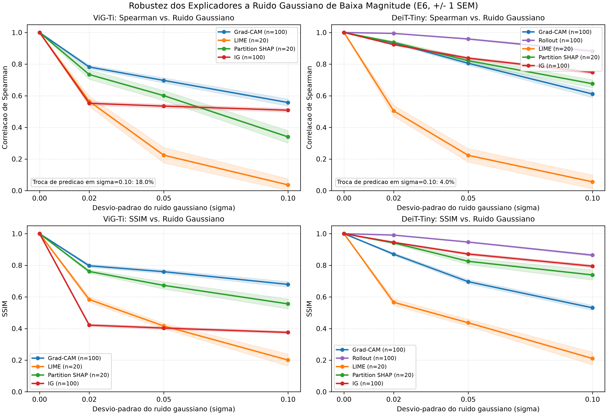

# E6: Teste de Robustez a Ruido Gaussiano

## Objetivo
Avaliar a estabilidade das explicacoes *post-hoc* (Grad-CAM, Attention Rollout, LIME, Partition SHAP e Integrated Gradients) e das proprias predicoes quando ruido gaussiano de baixa magnitude (`sigma in {0.02, 0.05, 0.10}` em `[0, 1]`) e adicionado as imagens de entrada em `xai_subset.csv`.

## Configuracao Executada
- Script: `python -m scripts.evaluate --experiment e6` (`src/metrics/robustness.py` e `scripts/evaluate.py`).
- Dispositivo: CUDA (`NVIDIA GeForce RTX 4070 Laptop GPU`), `allow_tf32=False`, `seed=42`.
- Geracao do ruido: aditivo gaussiano deterministico por imagem e nivel `sigma` (`seed = 42 + 10000*(std_idx + 1) + idx`), com clipe em `[0, 1]` e conversao direta `float32` para tensor normalizado (sem quantizacao uint8). As mesmas imagens ruidosas foram compartilhadas pelos dois modelos.
- Cobertura de amostra: `N = 100` para Grad-CAM, Attention Rollout e Integrated Gradients; `N = 20` estratificado (2 imagens por classe) para LIME e Partition SHAP.
- Tempo total: `696.28s` (`~11.6 min`).
- Artefatos gerados:
  - [`results/metrics/e6_robustness_per_image.csv`](../../results/metrics/e6_robustness_per_image.csv)
  - [`results/metrics/e6_robustness_summary.csv`](../../results/metrics/e6_robustness_summary.csv)
  - [`results/metrics/e6_robustness_summary.json`](../../results/metrics/e6_robustness_summary.json)
  - [`results/metrics/e6_wilcoxon_tests.csv`](../../results/metrics/e6_wilcoxon_tests.csv)
  - [`results/figures/e6_noise_robustness.pdf`](../../results/figures/e6_noise_robustness.pdf) e [`.png`](../../results/figures/e6_noise_robustness.png)

## Estabilidade das Predicoes (`N = 100`)

| Modelo | `sigma` | Trocas de predicao | P(classe alvo E1) medio +/- DP |
| :--- | :---: | :---: | :---: |
| `ViG-Ti` | `0.02` | `1/100` (`1.0%`) | `0.9724 +/- 0.1282` |
| `ViG-Ti` | `0.05` | `6/100` (`6.0%`) | `0.9332 +/- 0.2155` |
| `ViG-Ti` | `0.10` | `18/100` (`18.0%`) | `0.8015 +/- 0.3577` |
| `DeiT-Tiny` | `0.02` | `1/100` (`1.0%`) | `0.9815 +/- 0.0868` |
| `DeiT-Tiny` | `0.05` | `3/100` (`3.0%`) | `0.9654 +/- 0.1401` |
| `DeiT-Tiny` | `0.10` | `4/100` (`4.0%`) | `0.9481 +/- 0.1884` |

## Estabilidade dos Mapas vs. E2 (`sigma = 0.00`)

### ViG-Ti
| Metodo | `N` | `sigma=0.02` (Spearman / SSIM) | `sigma=0.05` (Spearman / SSIM) | `sigma=0.10` (Spearman / SSIM) | Mapas const. (`0.10`) |
| :--- | :---: | :---: | :---: | :---: | :---: |
| `Grad-CAM` | `100` | `0.7818` / `0.7969` | `0.6969` / `0.7595` | `0.5572` / `0.6792` | `0` |
| `LIME` | `20` | `0.5647` / `0.5835` | `0.2241` / `0.4161` | `0.0363` / `0.2008` | `9` |
| `Partition SHAP` | `20` | `0.7342` / `0.7610` | `0.6007` / `0.6729` | `0.3400` / `0.5559` | `0` |
| `Integrated Gradients` | `100` | `0.5522` / `0.4216` | `0.5346` / `0.4031` | `0.5085` / `0.3756` | `0` |

### DeiT-Tiny
| Metodo | `N` | `sigma=0.02` (Spearman / SSIM) | `sigma=0.05` (Spearman / SSIM) | `sigma=0.10` (Spearman / SSIM) | Mapas const. (`0.10`) |
| :--- | :---: | :---: | :---: | :---: | :---: |
| `Grad-CAM` | `100` | `0.9351` / `0.8704` | `0.8053` / `0.6964` | `0.6111` / `0.5313` | `0` |
| `Attention Rollout` | `100` | `0.9942` / `0.9909` | `0.9590` / `0.9470` | `0.8823` / `0.8642` | `0` |
| `LIME` | `20` | `0.5042` / `0.5662` | `0.2232` / `0.4368` | `0.0556` / `0.2107` | `9` |
| `Partition SHAP` | `20` | `0.9377` / `0.9418` | `0.8220` / `0.8253` | `0.6761` / `0.7389` | `0` |
| `Integrated Gradients` | `100` | `0.9235` / `0.9449` | `0.8379` / `0.8712` | `0.7478` / `0.7945` | `0` |

## Testes Pareados de Wilcoxon (`ViG-Ti` vs. `DeiT-Tiny` e `DeiT Grad-CAM` vs. `Rollout`)
- **Grad-CAM (Spearman):** `DeiT-Tiny` supera `ViG-Ti` em `sigma=0.02` (`0.935` vs `0.782`, `p = 9.07e-16`) e `sigma=0.05` (`0.805` vs `0.697`, `p = 5.45e-7`); em `sigma=0.10`, a diferenca em Spearman perde significancia (`0.611` vs `0.557`, `p = 0.114`), e `ViG-Ti` passa a preservar mais SSIM estrutural (`0.679` vs `0.531`, `p = 4.49e-8`).
- **Integrated Gradients (Spearman e SSIM):** `DeiT-Tiny` e altamente superior em todos os niveis de ruido (`p = 3.90e-18` em `0.02`, `0.05` e `0.10`), refletindo que o ruido altera imediatamente as arestas discretas `topk` ao longo da integral na `ViG-Ti`.
- **Partition SHAP:** `DeiT-Tiny` supera `ViG-Ti` em `0.02`, `0.05` e `0.10` tanto em Spearman (`p <= 3.81e-6`) quanto em SSIM (`p <= 2.33e-3`).
- **LIME:** sem diferenca significativa entre arquiteturas (`p >= 0.165` em todos os niveis): ambos colapsam rapidamente conforme o ruido muda os superpixels SLIC (`9/20` mapas constantes por classe em `sigma=0.10`).
- **DeiT Rollout vs. DeiT Grad-CAM:** Rollout exibe estabilidade muito superior em todos os niveis (`p <= 5.62e-16`), coerente com o efeito de filtro passa-baixa da agregacao de atencao em 12 blocos e sua insensibilidade ao logit da classe.

## Figura Gerada

## Observacoes Principais
1. A `ViG-Ti` e mais vulneravel a ruido gaussiano de alta frequencia do que o `DeiT-Tiny`: com `sigma=0.10`, a taxa de inversao de predicao atinge `18.0%` na `ViG-Ti` contra `4.0%` no `DeiT-Tiny`.
2. Mesmo em `sigma=0.02` (apenas `1%` de troca de predicao), IG (`0.552`) e Grad-CAM (`0.782`) na `ViG-Ti` sofrem queda bem maior do que no `DeiT-Tiny` (`0.923` e `0.935`), consistente com a troca de vizinhos $k$-NN no espaco de features.
3. Alta estabilidade a ruido (como Rollout no `DeiT-Tiny`, `Spearman=0.882` em `sigma=0.10`) nao implica fidelidade funcional: como visto em E3 e E4, o Rollout falha no sanity check da cabeca (`Spearman=1.0`) e tem Deletion AUC elevado (`0.672`).
4. O colapso do LIME em `sigma=0.05` e `0.10` decorre da fragilidade do algoritmo SLIC (`skimage.segmentation.slic`, `compactness=10.0`, `enforce_connectivity=True`) diante de ruido pixel a pixel no espaco CIELAB: nas 20 imagens estratificadas, a mediana de superpixels gerados cai de `34.5` (`sigma=0.00`) para `31.0` (`0.02`), `10.5` (`0.05`) e `2.0` (`0.10`), com `9/20` imagens colapsando para exatamente `1` unico superpixel em `sigma=0.10` (gerando os `9/20` mapas constantes identicos nos dois modelos). A degradacao do LIME em E6 reflete, portanto, a sensibilidade da segmentacao SLIC a montante, e nao instabilidade interna das redes.
